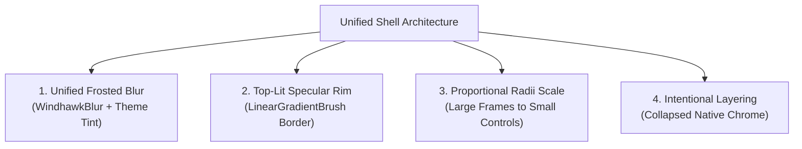

# Architecture & Design Philosophy

The **Windhawk Themes** framework approaches Windows 11 customization through a universal engineering model: structured XAML style injection, predictable token systems, and modular visual layers.

Rather than applying ad-hoc visual tweaks that look inconsistent or break across shell updates, themes engineered with this framework adhere to a strict visual contract governed by core styling pillars.

---

## 1. The Four Core Pillars



### 1. Unified Frosted Blur
- The base panel surface uses the direct composition `WindhawkBlur` shader to blur the desktop behind the panel.
- Tints dynamically derive from `{ThemeResource SystemChromeMediumColor}` (panels) or `{ThemeResource SystemAltLowColor}` (cards and flyouts) so the surface adapts seamlessly between light and dark Windows themes.

### 2. Top-Lit Glass Rim
- Outer panels and floating cards carry a specular vertical rim lighting effect:
  ```yaml
  BorderBrush:=<LinearGradientBrush StartPoint="0,0" EndPoint="0,1">
    <GradientStop Color="#60808080" Offset="0.0"/>
    <GradientStop Color="#40808080" Offset="1.0"/>
  </LinearGradientBrush>
  ```
- Specular thickness is asymmetric (`0,1,0,1`), giving the physical illusion of ambient light catching the upper and lower edges of glass sheets.

### 3. Harmonized Radii Scale
Corner radii follow a proportional hierarchy rather than one value applied everywhere — a larger radius on top-level frames and flyout hosts, tapering down to small radii on search boxes, cards, tiles, buttons, and compact controls such as context menus and tooltips. Choosing your own ratio between the largest and smallest radius keeps nested surfaces visually consistent.

### 4. Intentional Layering & Collapsed Chrome
- Native Windows 11 chrome features heavy opaque background fills and aggressive hard drop shadows that muddy translucent themes.
- A translucent theme typically collapses native shadows (`Shadow:=`, `BorderThickness=0`) and sets opaque panel fills to transparent (`Visibility=1` or `Background:=Transparent`), letting the glass panes and layered cards float crisply.

---

## 2. Process & Framework Boundaries

Each styler mod runs inside a distinct Windows host process and operates within a specific XAML framework runtime:

| Surface | Host Process | XAML Framework |
|---|---|---|
| **Start Menu** | `StartMenuExperienceHost.exe` | UWP / WinUI 2 (`Windows.UI.Xaml`) |
| **Taskbar** | `explorer.exe` | WinUI 3 / XAML |
| **Notification Center & Quick Settings** | `ShellExperienceHost.exe`<br>`ShellHost.exe` | UWP `Windows.UI.Xaml` |
| **Settings** | `SystemSettings.exe` | UWP / WinUI `Windows.UI.Xaml` |
| **File Explorer** | `explorer.exe` | WinUI 3 `Microsoft.UI.Xaml` |

Selectors and properties cannot be blindly copied between mods:
- UWP surfaces use Windows.UI.Xaml types and syntax conventions.
- WinUI 3 surfaces use Microsoft.UI.Xaml types.
- Mod-specific top-level keys (such as `webContentStyles` or `backgroundTranslucentEffect`) are isolated to the mods that support them.
