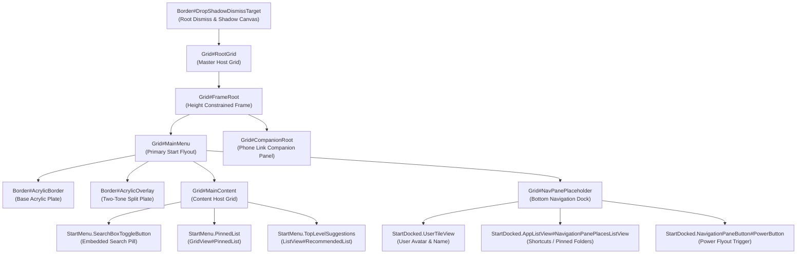

# Start Menu Visual Tree Element Targets

Complete technical reference and living catalog of verified XAML visual tree element names, types, control hierarchies, and visual state behaviors in `StartMenuExperienceHost.exe` (Windows 11 Start Menu).

> [!NOTE]
> The styling notes below name the XAML **properties** you can set on each target. They intentionally prescribe no theme values — pick your own fills, radii, and spacing.

---

## Architecture & Visual Tree Topology

The Windows 11 Start Menu runs as an isolated UWP app package hosted by `StartMenuExperienceHost.exe`. Its visual tree uses the standard UWP `Windows.UI.Xaml` framework, with secondary integration into `SearchHost.exe` / `SearchApp.exe` for embedded search flyouts and WebView2 edge content.

---

## 1. Root & Master Framing Targets

The outermost visual tree controls manage window bounds, shell drop-shadow generation, and high-contrast system borders.

| Element Selector | Class Type | Verified Builds | Behavior & Styling Notes |
|---|---|---|---|
| `Border#DropShadowDismissTarget` | `Windows.UI.Xaml.Controls.Border` | Win11 21H2 – 24H2 | Root drop-shadow and dismiss host. Collapsing it (`Visibility=Collapsed`) removes the native dark halo; the panel that carries the visible glass surface is `Grid#Root > Border` (stylable: `Background`, `BorderBrush`, `BorderThickness`, `CornerRadius`). |
| `Border#StartDropShadow`, `Border#RightCompanionDropShadow`, `Border#RootGridDropShadow`, `Border#dropshadow` | `Windows.UI.Xaml.Controls.Border` | Win11 21H2 – 24H2 | Native system drop-shadow borders. Collapse (`Visibility=Collapsed`) to eliminate opaque black silhouettes behind transparent glass. |
| `Border#MainMenuHighContrastBorder`, `Border#RightCompanionHighContrastBorder` | `Windows.UI.Xaml.Controls.Border` | Win11 21H2 – 24H2 | High-contrast accessibility boundary borders. Normally left untouched. |
| `Border#LayerBorder`, `Border#AccentLayerBorder`, `Border#AccentAppBorder` | `Windows.UI.Xaml.Controls.Border` | Win11 22H2 – 24H2 | Internal accent highlighting layers. Collapse (`Visibility=Collapsed`) to eliminate unwanted solid color bars. |
| `Border#AcrylicBorder`, `Grid#MainMenu > Border#AcrylicBorder`, `Grid#CompanionRoot > Border#AcrylicBorder` | `Windows.UI.Xaml.Controls.Border` | Win11 21H2 – 24H2 | Default system acrylic background plate. The main-menu acrylic (`Grid#MainMenu > Border#AcrylicBorder`) and the docked companion variant (`StartDocked.StartMenuCompanion#RightCompanion > Grid#CompanionRoot > Border#AcrylicBorder`) are collapsed (`Visibility=Collapsed`); the companion-pane acrylic (`Grid#CompanionRoot > Border#AcrylicBorder`) is the surface that carries the visible fill (stylable: `Background`, `CornerRadius`). |
| `Border#AcrylicOverlay` | `Windows.UI.Xaml.Controls.Border` | Win11 21H2 – 24H2 | Two-tone navigation split overlay card that covers the bottom third of the Start Menu. Set `Visibility=Collapsed` or `Background:=Transparent` for a seamless single-pane glass surface. |
| `Grid#FrameRoot` | `Windows.UI.Xaml.Controls.Grid` | Win11 21H2 – 24H2 | Top layout container enforcing maximum flyout dimensions. Constrain with `MaxHeight` so vertical bounds align cleanly on small displays. |
| `Grid#MainMenu` | `Windows.UI.Xaml.Controls.Grid` | Win11 21H2 – 24H2 | Main content column container. Set `Width` / `Height` to size the primary Start area while companion cards (Phone Link) expand to the right. |
| `Grid#MainContent` | `Windows.UI.Xaml.Controls.Grid` | Win11 21H2 – 24H2 | Houses search, pinned grid, and recommendations. Standard layout assignment: `Grid.Row`, `MinHeight`. |
| `Windows.UI.Xaml.Controls.Primitives.ScrollBar` | `ScrollBar` | Win11 21H2 – 24H2 | Root scrollbar elements. Collapsing (`Visibility=Collapsed`) hides intrusive vertical scrollbars during flyout animations. |

---

## 2. Embedded Search Bar Targets

The search box at the top of the Start Menu acts as an interactive button that triggers the full Windows Search experience or embeds an inline `AutoSuggestBox`.

| Element Selector | Class Type | Verified Builds | Behavior & Styling Notes |
|---|---|---|---|
| `StartMenu.SearchBoxToggleButton` | Custom Toggle Control | Win11 22H2 – 24H2 | Top search entry pill. Stylable: `Width`, `Height`, `HorizontalAlignment`, `Margin`, `Background`, `BorderThickness`. |
| `StartMenu.SearchBoxToggleButton > Grid@CommonStates > Border#BorderElement` | `Windows.UI.Xaml.Controls.Border` | Win11 22H2 – 24H2 | Search pill background plate. Stylable: `Background`, `BorderBrush`, `CornerRadius`, plus interactive `@PointerOver` state overrides. |
| `StartMenu.SearchBoxToggleButton > Grid > Grid#UnderlineContainer` | `Windows.UI.Xaml.Controls.Grid` | Win11 22H2 – 24H2 | Native bottom accent focus underline. Set `Visibility=Collapsed` for a clean pill aesthetic. |
| `StartMenu.SearchBoxToggleButton > Grid > FontIcon#SearchGlyph` | `Windows.UI.Xaml.Controls.FontIcon` | Win11 22H2 – 24H2 | Magnifying glass icon. Stylable: `FontSize`, `Margin`, `VerticalAlignment`. |
| `StartMenu.SearchBoxToggleButton > Grid > ContentPresenter > TextBlock#PlaceholderText` | `Windows.UI.Xaml.Controls.TextBlock` | Win11 22H2 – 24H2 | "Type here to search" placeholder label. Stylable: `FontSize`, `VerticalAlignment`. |
| `AutoSuggestBox#SearchBox` | `Windows.UI.Xaml.Controls.AutoSuggestBox` | Win11 21H2 | Legacy search input element on 21H2 builds. |
| `Border#SearchBoxBorder` | `Windows.UI.Xaml.Controls.Border` | Win11 21H2 | Legacy background plate on 21H2. |
| `TextBox#SearchTextBox` | `Windows.UI.Xaml.Controls.TextBox` | Win11 21H2 | Legacy input text box. |

---

## 3. Pinned Applications & Items Grid

Controls rendering pinned app shortcuts, grid dimensions, and item hover cards.

| Element Selector | Class Type | Verified Builds | Behavior & Styling Notes |
|---|---|---|---|
| `StartMenu.PinnedList` | Custom Items Control | Win11 22H2 – 24H2 | Container for pinned apps. Supports dynamic height binding via Windhawk state capture (`ActualHeight=>pinnedListHeight`), plus `Margin`, `MaxWidth`, `MinHeight`. |
| `StartMenu.PinnedList > Grid#Root > GridView#PinnedList > Border` | `Windows.UI.Xaml.Controls.Border` | Win11 22H2 – 24H2 | Background card wrapping the pinned icons grid. Stylable: `Background`, `BorderBrush`, `CornerRadius`, `Padding`. |
| `GridView#PinnedList` | `Windows.UI.Xaml.Controls.GridView` | Win11 21H2 – 24H2 | Primary grid view hosting pinned application icons. Center-aligned via `HorizontalAlignment`. |
| `GridViewItem` | `Windows.UI.Xaml.Controls.GridViewItem` | Win11 21H2 – 24H2 | Item wrapper for individual pinned apps. |
| `TextBlock#PinnedListHeaderText` | `Windows.UI.Xaml.Controls.TextBlock` | Win11 21H2 – 24H2 | "Pinned" section header text. Set `Text=""` to eliminate header clutter. |
| `StartMenu.CategoryControl` | Custom Control | Win11 24H2 | Category grouping control on new 24H2 grid layouts. Stylable: `Margin`. |
| `StartMenu.CategoryControl > Grid#RootGrid > Border` | `Windows.UI.Xaml.Controls.Border` | Win11 24H2 | Outer card border for category groups. Stylable: `Background`, `CornerRadius`. |

---

## 4. Recommendations & Recent Files

Controls managing recent documents, recommended apps, and expander toggles.

| Element Selector | Class Type | Verified Builds | Behavior & Styling Notes |
|---|---|---|---|
| `Windows.UI.Xaml.Controls.GridView#RecommendedList` | `GridView` | Win11 21H2 – 24H2 | Recommended items list. In minimal layouts, collapse with `Visibility=Collapsed`. |
| `Grid#TopLevelSuggestionsRoot` | `Windows.UI.Xaml.Controls.Grid` | Win11 22H2 – 24H2 | Container hosting suggestion items. Layout: `Grid.Row`. |
| `Grid#ShowMoreSuggestions` | `Windows.UI.Xaml.Controls.Grid` | Win11 22H2 – 24H2 | Expander container. Supports reactive visibility binding: `Visibility={{showMoreSuggestionsVisible}}`. |
| `Button#ShowMoreSuggestionsButton` | `Windows.UI.Xaml.Controls.Button` | Win11 22H2 – 24H2 | "More" chevron button. Stylable: `Margin`, `Height`, `CornerRadius`. |
| `Button#ShowMoreSuggestionsButton > Windows.UI.Xaml.Controls.Grid@CommonStates` | `Windows.UI.Xaml.Controls.Grid` | Win11 22H2 – 24H2 | Interactive state border. Stylable: `BorderBrush`, `BorderThickness`, `CornerRadius`. |
| `Button#HideMoreSuggestionsButton` | `Windows.UI.Xaml.Controls.Button` | Win11 22H2 – 24H2 | Back chevron button when recommendations are expanded. Stylable: `Margin`, `Height`, `Width`, `CornerRadius`. |
| `Microsoft.UI.Xaml.Controls.DropDownButton` | WinUI DropDownButton | Win11 23H2 – 24H2 | Category drop-down button in recommendations header. Supports a `RenderTransform` with a `TranslateTransform` driven by captured dynamic state (e.g. `pinnedListHeight`). |

---

## 5. All Apps List & Alphabetical Navigation

Controls rendering the full list of installed programs.

| Element Selector | Class Type | Verified Builds | Behavior & Styling Notes |
|---|---|---|---|
| `Windows.UI.Xaml.Controls.Grid#AllAppsRoot` | `Grid` | Win11 21H2 – 24H2 | Root container for the full installed applications list. |
| `Grid#TopLevelHeader > Grid > Button[AutomationProperties.Name=Show all]` | `Button` | Win11 22H2 – 24H2 | "All apps" header pill button. Stylable: `Width`, `Height`, `CornerRadius`, `Background@Normal`. |
| `Windows.UI.Xaml.Controls.GridView#AllAppsGrid > Border > ScrollViewer > Border > Grid > ScrollContentPresenter > ItemsPresenter > ItemsWrapGrid` | `ItemsWrapGrid` | Win11 21H2 – 24H2 | Inner wrap grid layout for installed apps. Stylable: `Margin`. |
| `TextBlock#AllListHeadingText` | `Windows.UI.Xaml.Controls.TextBlock` | Win11 21H2 – 24H2 | "All apps" section header label. Stylable: `Margin`; set `Text=""` to hide. |
| `TextBlock#ZoomedOutHeading` | `Windows.UI.Xaml.Controls.TextBlock` | Win11 21H2 – 24H2 | Zoomed-out alphabet jump list heading. Collapse via `Visibility=Collapsed`. |

---

## 6. Bottom Navigation Pane & Power Controls

The bottom navigation strip hosting the user avatar, folder shortcuts, and the power flyout button.

| Element Selector | Class Type | Verified Builds | Behavior & Styling Notes |
|---|---|---|---|
| `Grid#NavPanePlaceholder` | `Windows.UI.Xaml.Controls.Grid` | Win11 21H2 – 24H2 | Bottom navigation row placeholder. Constrain with `MaxHeight`. |
| `StartDocked.NavigationPaneView > Grid#RootPanel` | `Windows.UI.Xaml.Controls.Grid` | Win11 22H2 – 24H2 | Navigation pane layout root. Set `Background:=Transparent` and `BorderBrush:=Transparent` to eliminate the dark bottom bar. |
| `StartDocked.UserTileView` | Custom Control | Win11 21H2 – 24H2 | User account avatar and username host. Constrain with `Height`. |
| `StartDocked.NavigationPaneButton#UserTileButton > Grid > Border#BackgroundBorder` | `Border` | Win11 21H2 – 24H2 | Avatar card pill background. Stylable: `Background`, `BorderBrush`, `CornerRadius`. |
| `Grid#UserTileIcon` | `Windows.UI.Xaml.Controls.Grid` | Win11 21H2 – 24H2 | Circular user avatar container. Sized via `Height`, `Width`. |
| `TextBlock#UserTileNameText` | `Windows.UI.Xaml.Controls.TextBlock` | Win11 21H2 – 24H2 | Display name label. Stylable: `FontSize`. |
| `StartDocked.AppListView#NavigationPanePlacesListView` | `AppListView` | Win11 21H2 – 24H2 | Pinned folder shortcut icons (Settings, File Explorer, Downloads, etc.). Stylable: `Height`, `Margin`. |
| `StartDocked.AppListView#NavigationPanePlacesListView > Border` | `Border` | Win11 21H2 – 24H2 | Background card wrapping folder shortcuts. Stylable: `CornerRadius`, `Background`. |
| `StartDocked.PowerOptionsView` | Custom Control | Win11 21H2 – 24H2 | Power menu button container. Stylable: `Height`. |
| `StartDocked.NavigationPaneButton#PowerButton` | `NavigationPaneButton` | Win11 21H2 – 24H2 | Power options trigger button. Stylable: `Height`, `Width`, `CornerRadius`. |
| `StartDocked.NavigationPaneButton#PowerButton > Grid@CommonStates > Border#BackgroundBorder` | `Border` | Win11 21H2 – 24H2 | Power button interactive background card. Stylable: `Background`, `BorderBrush`, `BorderThickness`. |
| `StartDocked.NavigationPaneButton#PowerButton > Grid > ContentPresenter > Grid > FontIcon` | `FontIcon` | Win11 21H2 – 24H2 | Power icon glyph. Stylable: `FontSize`. |

---

## 7. Phone Link Companion Panel Targets

Windows 11 builds 23H2+ and 24H2 introduce a side companion panel docked to the right of the Start Menu displaying phone battery, recent photos, and messages.

| Element Selector | Class Type | Verified Builds | Behavior & Styling Notes |
|---|---|---|---|
| `StartDocked.StartMenuCompanion#RightCompanion > Grid#CompanionRoot`, `StartMenu.StartMenuCompanion#RightCompanion > Grid#CompanionRoot` | `Grid` | Win11 23H2 – 24H2 | Companion root card docked to Start. Supports asymmetric corner rounding (per-side `CornerRadius`) and independent `Margin` / `Padding`. |
| `ToggleButton#ShowHideCompanion` | `ToggleButton` | Win11 23H2 – 24H2 | Toggle button in header to collapse or expand the companion card. Stylable: `Height`, `Width`, `CornerRadius`. |
| `ToggleButton#ShowHideCompanion > Border` | `Border` | Win11 23H2 – 24H2 | Interactive state background plate for the companion toggle. Stylable: `Background`, plus `@PointerOver` and `@Pressed` state overrides. |
| `ContentPresenter#PrimaryCardContainer` | `ContentPresenter` | Win11 23H2 – 24H2 | Container hosting Adaptive Cards for phone telemetry and messages. Stylable: `Margin`. |
| `AdaptiveCards.Rendering.Uwp.WholeItemsPanel > Grid > Border > AdaptiveCards.Rendering.Uwp.WholeItemsPanel > Grid > ListView > Border` | `Border` | Win11 23H2 – 24H2 | Individual phone item cards. Stylable: `Background`, `BorderBrush`, `CornerRadius`. |
| `Grid#ActionsBar` | `Grid` | Win11 23H2 – 24H2 | Bottom quick actions bar within the companion panel. Stylable: `Height`, `VerticalAlignment`, `Margin`, `Background`, `CornerRadius`. |
| `Grid#ActionsBar > Button` | `Button` | Win11 23H2 – 24H2 | Action buttons inside companion bar. Stylable: `Height`, `Width`, `Background`, `BorderThickness`. |

---

## 8. Folder Modals, Popups & Flyouts

Popups and flyout menus triggered within the Start Menu experience.

| Element Selector | Class Type | Verified Builds | Behavior & Styling Notes |
|---|---|---|---|
| `StartMenu.FolderModal#StartFolderModal > Grid#Root` | `Grid` | Win11 22H2 – 24H2 | Expanded app folder popup modal. Sized via `MaxHeight`, `MaxWidth`, `Height`, `Width`. |
| `StartMenu.UniversalTileContainer#UniversalTileContainer > Grid#GridViewContainer` | `Grid` | Win11 22H2 – 24H2 | Grid container inside folder modals. Stylable: `Width`, `Height`. |
| `FlyoutPresenter > Border#BackgroundElement`, `FlyoutPresenter > Border` | `Border` | Win11 21H2 – 24H2 | Context popup flyout background card. Stylable: `Background`, `BorderBrush`, `CornerRadius`, `Padding`. |
| `MenuFlyoutPresenter > Border#BackgroundElement`, `MenuFlyoutPresenter > Border` | `Border` | Win11 21H2 – 24H2 | Context menu flyout container. Stylable: `Background`, `BorderBrush`, `CornerRadius`. |
| `MenuFlyoutItem`, `ToggleMenuFlyoutItem` | Menu Items | Win11 21H2 – 24H2 | Individual context menu item rows. Stylable: `CornerRadius`, `Margin`. |
| `ToolTip > ContentPresenter#LayoutRoot` | `ContentPresenter` | Win11 21H2 – 24H2 | Tooltip popup pill. Stylable: `Background`, `BorderBrush`, `CornerRadius`. |
| `Border#BackgroundBorder, Grid#LayoutRoot` | `Border`, `Grid` | Win11 21H2 – 24H2 | Fluid hover transitions: supports `BackgroundTransition:=<BrushTransition Duration="0:0:0.083" />`. |
