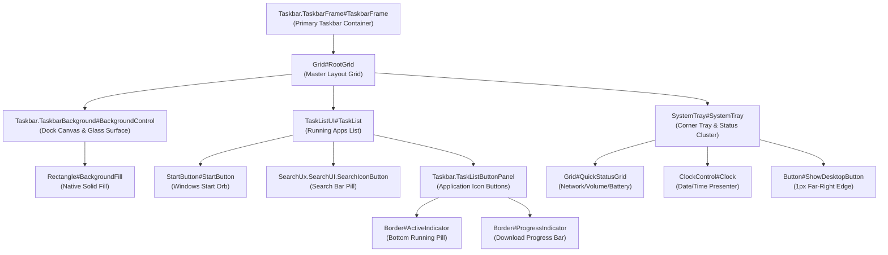

# Taskbar Visual Tree Element Targets

Complete technical reference and living catalog of verified WinUI 3 XAML visual tree element names, types, control hierarchies, and visual state behaviors in `explorer.exe` (Windows 11 Taskbar).

---

## Architecture & Visual Tree Topology

The Windows 11 Taskbar is implemented as a modern WinUI 3 XAML island running directly within `explorer.exe`. It uses the `Microsoft.UI.Xaml` framework, featuring high-performance DirectComposition visual trees, advanced hardware-accelerated animations, and responsive adaptive layouts.

---

## 1. Root Taskbar Frame & Canvas Targets

Controls managing the overall dock boundaries, margins, corner rounding, and background glass surfaces.

| Element Selector | Class Type | Verified Builds | Behavior & Styling Notes |
|---|---|---|---|
| `Taskbar.TaskbarFrame > Grid#RootGrid > Taskbar.TaskbarBackground > Grid`, `Taskbar.TaskbarBackground > Grid`, `Taskbar.TaskbarBackground#BackgroundControl > Grid` | `Windows.UI.Xaml.Controls.Grid` | Win11 21H2 – 24H2 | Main background grid of the taskbar. The glass surface is applied to the `Taskbar.TaskbarBackground#HoverFlyoutBackgroundControl` host (stylable: `Background`, `BorderBrush`, `BorderThickness`, `CornerRadius`); the taskbar remains flush with the display edges. |
| `Taskbar.TaskbarFrame > Grid#RootGrid > Taskbar.TaskbarBackground > Grid > Rectangle#BackgroundFill`, `Taskbar.TaskbarBackground > Grid > Rectangle#BackgroundFill` | `Windows.UI.Xaml.Shapes.Rectangle` | Win11 21H2 – 24H2 | Native system taskbar solid fill rectangle. Set to `Visibility=Collapsed` to prevent opaque system colors from masking custom frosted glass. |
| `Rectangle#BackgroundStroke` | `Windows.UI.Xaml.Shapes.Rectangle` | Win11 21H2 – 24H2 | Native top border stroke line. Collapsed (`Visibility=Collapsed`) to eliminate the harsh horizontal line. |
| `Taskbar.TaskbarBackground#HoverFlyoutBackgroundControl`, `Taskbar.TaskbarBackground#HoverFlyoutBackgroundControl > Grid` | `Windows.UI.Xaml.Controls.Grid` | Win11 22H2 – 24H2 | Frosted glass background host for the taskbar surface. Stylable: `Background`, `BorderBrush`, `BorderThickness`, `CornerRadius`. |
| `Taskbar.SecondaryTaskbarFrame#SecondaryTaskbarFrame` | `TaskbarFrame` | Win11 21H2 – 24H2 | Taskbar container rendered on secondary / external monitors. Inherits primary framing styles. |

---

## 2. Running Apps & Task List Buttons

Controls managing application icons, running state indicators, uncombined labels, and interactive mouse hover states.

| Element Selector | Class Type | Verified Builds | Behavior & Styling Notes |
|---|---|---|---|
| `Taskbar.TaskListButtonPanel@CommonStates > Grid > Border#BackgroundElement`, `Taskbar.TaskListButtonPanel@CommonStates > Border#BackgroundElement` | `Windows.UI.Xaml.Controls.Border` | Win11 21H2 – 24H2 | Application button card pill. Stylable: `Padding`, `Margin`, `CornerRadius`, plus multi-state background overrides: `Background@ActiveNormal`, `Background@ActivePointerOver`, `Background@InactivePointerOver`, `Background@MultiWindowNormal`. |
| `Grid#IconPanel@CommonStates > Border#BackgroundElement`, `Taskbar.TaskListLabeledButtonPanel@CommonStates > Border#BackgroundElement` | `Windows.UI.Xaml.Controls.Border` | Win11 23H2 – 24H2 | Button background for uncombined / labeled taskbar items. Stylable: `Width`, `Height`. |
| `Grid#IconPanel@RunningIndicatorStates > Rectangle#RunningIndicator`, `Taskbar.TaskListLabeledButtonPanel@RunningIndicatorStates > Rectangle#RunningIndicator` | `Windows.UI.Xaml.Shapes.Rectangle` | Win11 21H2 – 24H2 | Running app indicator pill. Stylable: `RadiusX`, `RadiusY`, `Height`, `Width`, `Fill`, `Fill@ActiveRunningIndicator`, `Width@ActiveRunningIndicator`. |
| `Microsoft.UI.Xaml.Controls.ProgressBar#ProgressIndicator` | `ProgressBar` | Win11 21H2 – 24H2 | Real-time file copy / download progress bar rendered across app buttons. Stylable: `Margin`. |
| `Windows.UI.Xaml.Shapes.Rectangle#ProgressBarTrack` | `Rectangle` | Win11 21H2 – 24H2 | Progress bar inactive track. Stylable: `Fill`, `RadiusX`, `RadiusY`. |
| `Windows.UI.Xaml.Shapes.Rectangle#DeterminateProgressBarIndicator` | `Rectangle` | Win11 21H2 – 24H2 | Active progress bar fill. Stylable: `Fill`. |
| `Taskbar.Badge#BadgeControl` | `Badge` | Win11 22H2 – 24H2 | Notification badge count bubble on taskbar icons. Stylable: `Height`, `MinWidth`, `CornerRadius`. |
| `TextBlock#TaskbarButtonLabel` | `Windows.UI.Xaml.Controls.TextBlock` | Win11 23H2 – 24H2 | Text label for uncombined taskbar buttons. |

---

## 3. Start Button & Search Box Targets

Controls rendering the Windows Start orb and embedded taskbar search inputs.

| Element Selector | Class Type | Verified Builds | Behavior & Styling Notes |
|---|---|---|---|
| `Taskbar.ExperienceToggleButton#LaunchListButton[AutomationProperties.AutomationId=StartButton]` | `ExperienceToggleButton` | Win11 21H2 – 24H2 | Windows Start orb button wrapper. Stylable: `VerticalAlignment`, `Margin`. |
| `Taskbar.ExperienceToggleButton#LaunchListButton[AutomationProperties.AutomationId=StartButton] > Taskbar.TaskListButtonPanel > Grid > AnimatedVisualPlayer#Icon` | `AnimatedVisualPlayer` | Win11 21H2 – 24H2 | Windows logo animated Lottie player. Scaled via a `RenderTransform` with a `ScaleTransform`; stylable: `Width`, `Height`. |
| `SearchUx.SearchUI.SearchIconButton > SearchUx.SearchUI.SearchButtonRootGrid#SearchBoxButtonRootPanel` | `Grid` | Win11 22H2 – 24H2 | Search icon button container. Stylable: `Background`, `BorderBrush`, `BorderThickness`, `CornerRadius`, `Width`, `Height`. |
| `SearchUx.SearchUI.SearchPillButton#SearchPill > SearchUx.SearchUI.SearchButtonRootGrid#SearchBoxButtonRootPanel` | `Grid` | Win11 22H2 – 24H2 | Expanded search pill bar. Stylable: `MaxWidth`, `MaxHeight`, `CornerRadius`. |
| `SearchUx.SearchUI.SearchButtonRootGrid#SearchBoxButtonRootPanel > Grid > Border#SearchPillBackgroundElement` | `Border` | Win11 22H2 – 24H2 | Background card for the expanded search pill. Stylable: `BorderBrush`, `CornerRadius`, `BorderThickness`. |
| `Grid#DynamicSearchBoxGleamContainer` | `Grid` | Win11 22H2 – 24H2 | Dynamic search gleam illustrations (daily doodles). Collapsed via `Visibility=Collapsed` to keep search clean. |
| `Taskbar.AugmentedEntryPointButton#AugmentedEntryPointButton` | `Button` | Win11 23H2 – 24H2 | Copilot / Windows intelligence entry point button on the taskbar. Stylable: `Margin`, `VerticalAlignment`. |

---

## 4. System Tray, Clock & Corner Flyout Triggers

Controls organizing the notification area, quick status pill (network/volume/battery), and clock presenter.

| Element Selector | Class Type | Verified Builds | Behavior & Styling Notes |
|---|---|---|---|
| `StackPanel#SystemTrayFrameGrid`, `Grid#SystemTrayFrameGrid` | `StackPanel`, `Grid` | Win11 21H2 – 24H2 | Main container for system tray icons and clock. Stylable: `Height`; surface cleared via `Background:=Transparent`, `BorderBrush:=Transparent`, `BorderThickness=0`, `Shadow:=`. |
| `Grid#OverflowRootGrid > Border` | `Border` | Win11 21H2 – 24H2 | Hidden tray icons overflow chevron menu card. Intentionally transparent: `Background:=Transparent`, `BorderBrush:=Transparent`, `BorderThickness=0`, `Shadow:=`; stylable: `Padding`. |
| `SystemTray.DateTimeIconContent` | Custom Content | Win11 21H2 – 24H2 | Embedded date/time icon content. Stylable: `FontSize`. |
| `TextBlock#DateInnerTextBlock` | `Windows.UI.Xaml.Controls.TextBlock` | Win11 21H2 – 24H2 | Secondary date string beneath the clock. Can be collapsed via `Visibility=Collapsed` for compact single-line clocks. |
| `Windows.UI.Xaml.Controls.Grid#VolumeConfirmator` | `Grid` | Win11 22H2 – 24H2 | Volume HUD confirmator toast popup. Stylable: `Padding`, `CornerRadius`. |
| `Windows.UI.Xaml.Controls.Grid#BrightnessConfirmator` | `Grid` | Win11 22H2 – 24H2 | Brightness HUD confirmator toast popup. Stylable: `Padding`, `CornerRadius`. |
| `Button#ShowDesktopButton` | `Button` | Win11 21H2 – 24H2 | Extreme right-hand 1px line that triggers Show Desktop. Can be collapsed via `Visibility=Collapsed`. |

---

## 5. Virtual Desktop & Snap Assist Controls

Flyouts and overlays triggered directly from the taskbar for window management.

| Element Selector | Class Type | Verified Builds | Behavior & Styling Notes |
|---|---|---|---|
| `Border#VirtualDesktopBarBackground` | `Border` | Win11 22H2 – 24H2 | Virtual desktop switcher bar background card. Stylable: `Background`, `BorderBrush`, `CornerRadius`. |
| `WindowsInternal.ComposableShell.Experiences.Switcher.VirtualDesktopElementThemed` | Custom Element | Win11 22H2 – 24H2 | Individual desktop preview thumbnail card. Stylable: `CornerRadius`. |
| `SnapLayout.SnapLayoutPickerControl`, `Windows.UI.Xaml.Controls.Border#SnapPickerBorder` | `SnapLayoutPickerControl`, `Border` | Win11 22H2 – 24H2 | Snap Assist flyout popup card. Stylable: `Background`, `BorderBrush`, `CornerRadius`. |
| `SnapLayout.SnapLayoutControl@CommonStates > Windows.UI.Xaml.Controls.Border#LayoutBorder` | `Border` | Win11 22H2 – 24H2 | Interactive snap zone preview. Stylable: `Background@PointerOver`, `Background@Pressed`. |
